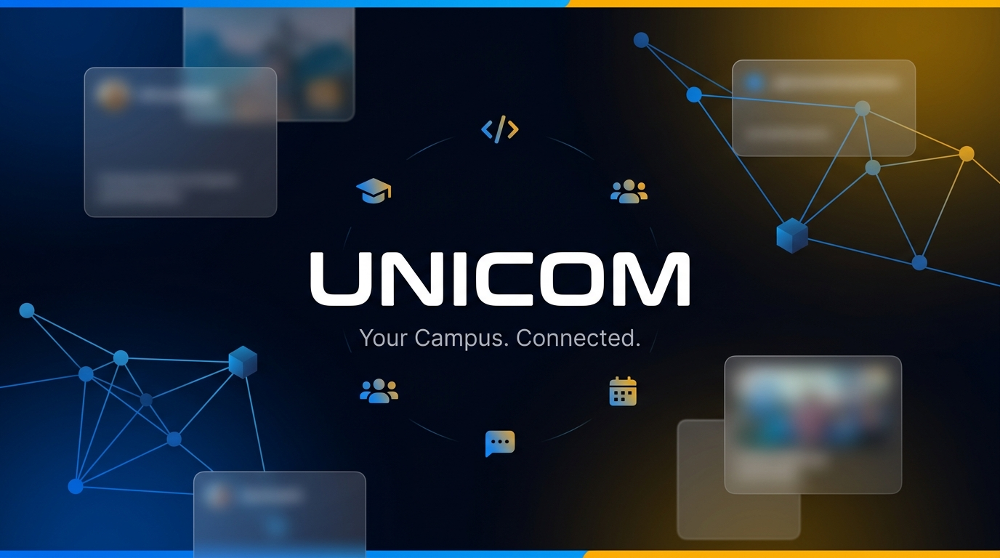
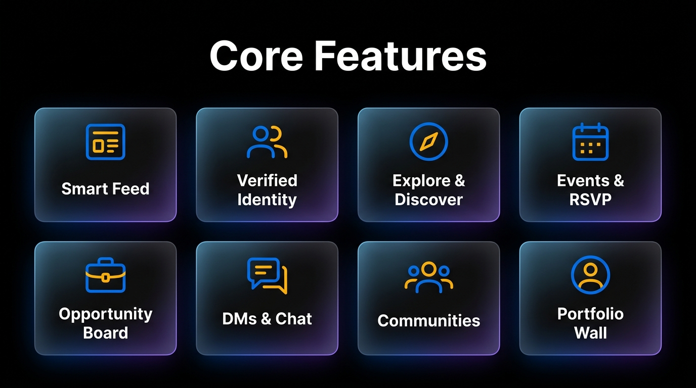
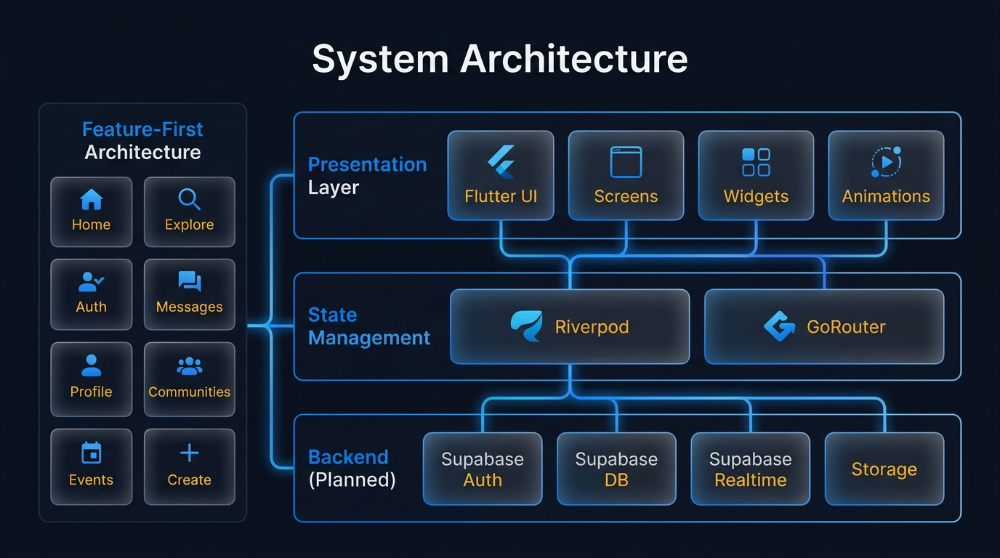
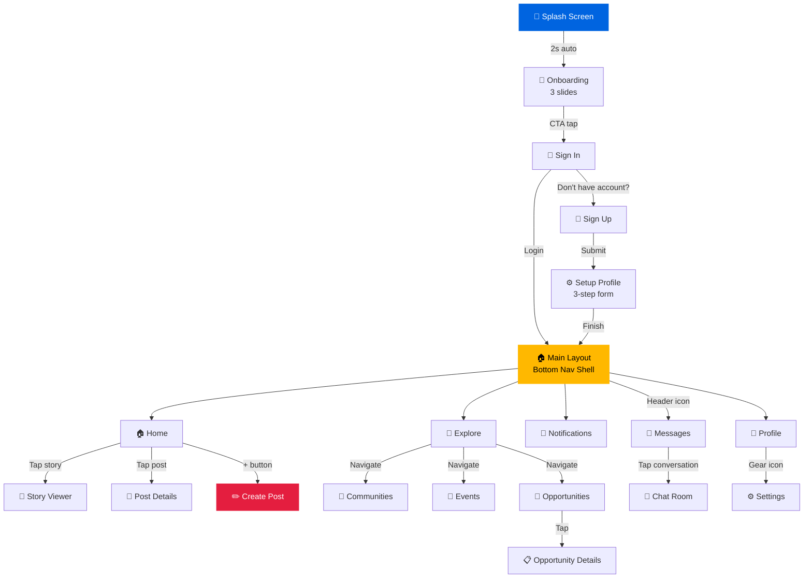
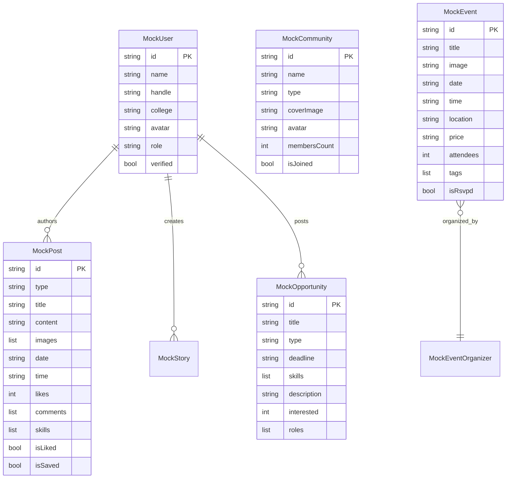
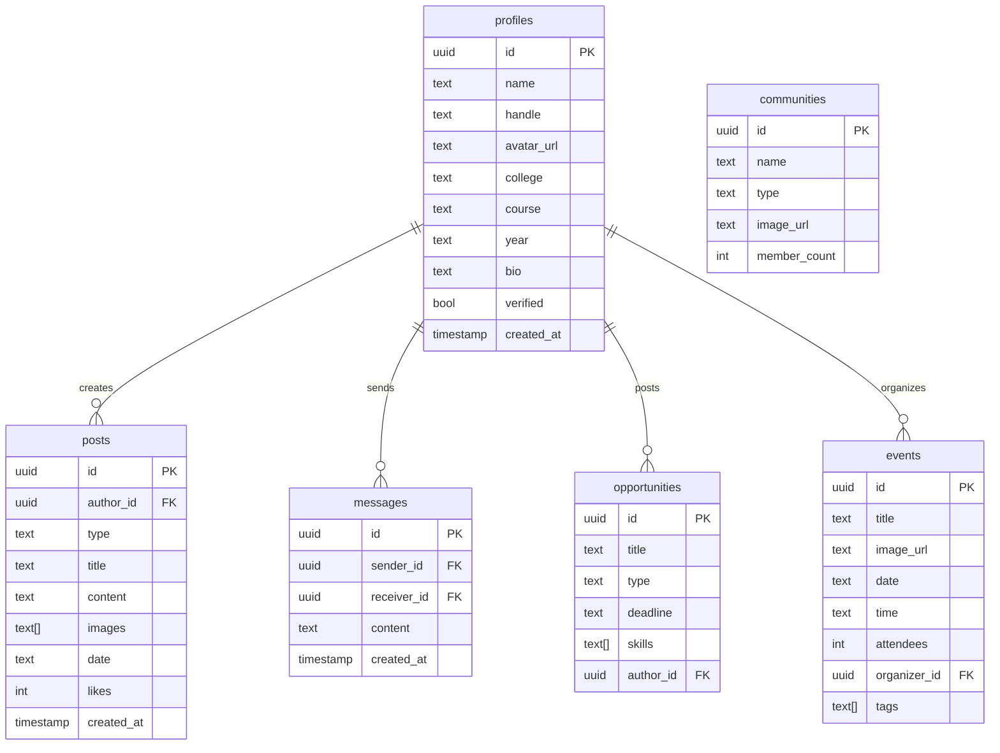
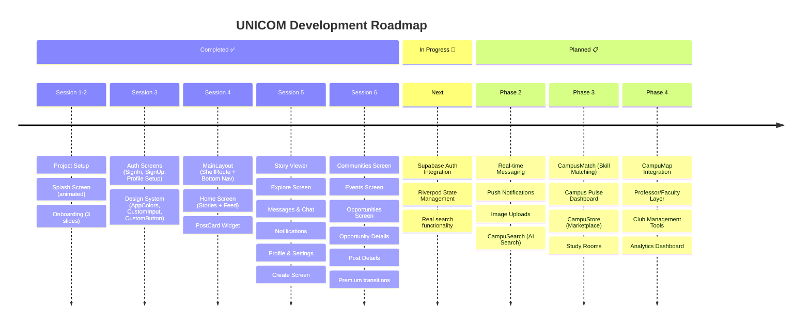

<div align="center">

<!-- Banner -->


<br/>
<br/>

<!-- Badges -->
[](https://flutter.dev)
[](https://dart.dev)
[](https://supabase.com)
[](https://riverpod.dev)
[](#)

<br/>

### 🎓 The College Super-App India Has Been Waiting For

**Instagram** for moments • **Reddit** for discussions • **LinkedIn** for networking • **Discord** for communities  
All fused into one verified, identity-anchored platform built exclusively for college life.

<br/>

[📱 Features](#-features) · [🏗️ Architecture](#%EF%B8%8F-architecture) · [🚀 Getting Started](#-getting-started) · [📖 Documentation](#-documentation) · [🗺️ Roadmap](#%EF%B8%8F-roadmap)

---

</div>

## 💡 The Insight

> *"Indian college students live in a paradox: they are surrounded by thousands of peers, yet deeply isolated by the lack of structured discovery. WhatsApp requires you to already know someone. Instagram rewards beauty over brains. LinkedIn punishes vulnerability. The result is that a brilliant student with a hackathon idea cannot find a UI/UX partner two buildings away — and a professor with a research grant cannot find the right student three floors below."*
>
> **UNICOM exists to collapse this invisible distance.**

<br/>

## 🎯 Why UNICOM?

<table>
<tr>
<td width="50%">

### 🔴 The Problem
- **40M+** higher ed students in India, deeply social yet digitally disconnected
- No single platform bridges **hyper-local campus** + **cross-college networking**
- WhatsApp needs you to already know someone
- Instagram rewards aesthetics, not skills
- LinkedIn is too corporate for college energy
- Anonymous apps (Fizz, Sidechat) breed toxicity

</td>
<td width="50%">

### 🟢 The Solution
- **Verified identity** via official college email (`.iit.ac.in`, `.bits.ac.in`)
- **Contextual privacy** — visible to the right people, private from others
- **Structured discovery** — find collaborators, teams, mentors, events
- **Multi-role platform** — Students, Professors, Clubs, Admins
- **Trust layer** — accountability without anonymity
- **Cross-college networking** made structured and intentional

</td>
</tr>
</table>

<br/>

## 📱 Features

<div align="center">

</div>

<br/>

### 🏠 Core Foundation

<details>
<summary><b>🔐 Verified Identity & Onboarding</b></summary>
<br/>

| Feature | Description |
|---------|-------------|
| **College Email Sign-up** | Authenticate via official email (`name@iit.ac.in`) — guarantees authenticity |
| **Campus Profile** | College-specific profile with course, year, and bio |
| **Interest Tagging** | 50+ categories: Dev, Design, Music, Sports, Finance, Research, etc. |
| **Skill Badges** | Self-declared skills with peer endorsement system |
| **Privacy Modes** | Public (cross-college visible) or Private (college-only) |
| **Multi-Role System** | Student, Professor, Club/Society, and College Admin roles |

</details>

<details>
<summary><b>📰 Feed & Content System</b></summary>
<br/>

| Feature | Description |
|---------|-------------|
| **Personalized Home Feed** | Algorithm-ranked posts from your college and interests |
| **Discover Feed** | Cross-college posts, trending topics, featured opportunities |
| **Rich Post Types** | Text, Image/Video, Poll, Event, Opportunity (Team/Collab), Resource Share |
| **Reddit-Style Voting** | Upvote/Downvote system surfaces quality content |
| **Nested Comments** | Threaded comment replies for deeper discussions |
| **Bookmarks** | Save posts into personal collections |
| **Tagging** | Tag users, clubs, and colleges in posts |

</details>

<details>
<summary><b>👥 Communities (Subreddits for College Life)</b></summary>
<br/>

| Feature | Description |
|---------|-------------|
| **Auto-Created** | College-specific communities for each institution |
| **Interest-Based** | Hackathon Hub, Startup Founders, Photography, Finance Nerds, etc. |
| **Open & Closed** | Cross-college open communities + invite-only/college-specific closed ones |
| **Admin Tools** | Pin posts, announcements, member moderation |
| **Event Communities** | Temporary communities auto-created for specific fests/hackathons |

</details>

<details>
<summary><b>💼 Opportunity Board</b></summary>
<br/>

| Category | Use Case |
|----------|----------|
| **🏆 Hackathon Teams** | Post team needs with required skills, deadline, hackathon type |
| **🔬 Research Collabs** | Professors/students post research needs with scope |
| **🎭 Club Recruitment** | Clubs post open roles with audition/interview dates |
| **🎪 Event Volunteering** | Fest committees post volunteer requirements |
| **✈️ Trip Groups** | Find travel companions for trips, treks, road trips |
| **📚 Study Groups** | Subject + exam + date → instant study group |
| **🚀 Startup Co-founders** | Post your idea + the co-founder profile you need |

</details>

<details>
<summary><b>💬 Messaging & Connections</b></summary>
<br/>

- **1:1 DMs** with read receipts and message requests
- **Group Chats** for project teams — up to 50 members
- **Connection System** — LinkedIn-style requests with accept/decline
- **Privacy Filtering** — control who can message you

</details>

<details>
<summary><b>📅 College Events & Calendar</b></summary>
<br/>

- **Verified Event Posting** — fests, seminars, workshops, hackathons
- **RSVP System** with attendee lists (optionally visible)
- **Campus Calendar** — all upcoming events from your college + followed communities
- **Inter-College Discovery** — browse fests and events at other colleges
- **Smart Reminders** — notification-powered event alerts

</details>

<br/>

### ⚡ Innovative USPs

<details>
<summary><b>🔍 CampuSearch — AI-Powered Contextual Search</b></summary>
<br/>

> Unlike standard search, CampuSearch understands **intent**. Typing *"hackathon team backend developer next month"* surfaces relevant opportunity posts, matching people, and upcoming hackathon events — all in one unified result. Think **Perplexity for campus life**.

- Semantic search across posts, people, communities, and events
- Smart filters: Within my college / Cross-college / By interest / By time
- Voice search support for regional language users

</details>

<details>
<summary><b>🤝 CampusMatch — Skill & Interest Match Engine</b></summary>
<br/>

> Set your goals → get proactively matched with the best people and opportunities. Like a **talent matchmaking layer**.

- Daily "You might want to connect with..." suggestions
- Team compatibility scoring — AI suggests top 5 matching profiles
- "Open to connect" toggle signals collaboration readiness

</details>

<details>
<summary><b>📊 Campus Pulse — Trending Insights Dashboard</b></summary>
<br/>

> Real-time heartbeat of campus life:

```
📈  "Most talked about topic this week at IIT Delhi: placement prep"
🏆  "3 hackathons happening in your city next month"  
🎨  "5 students from your college are looking for a graphic designer"
🔥  "Trending clubs near you: Entrepreneurship Cell"
```

</details>

<details>
<summary><b>🏅 Portfolio & Achievement Wall</b></summary>
<br/>

- **Project Cards** with images, descriptions, GitHub/Figma/YouTube links
- **Achievements** — hackathon wins, competitions, internships, publications
- **Certificate Verification** — auto-verify from Coursera, HackerRank, etc.
- **Professor Endorsements** — verified academic endorsements (trust layer LinkedIn can't match)
- **"Hire Me" / "Collab with Me"** toggle for active seekers

</details>

<details>
<summary><b>👻 Incognito Post — Anonymous Mode</b></summary>
<br/>

> Safe pressure valve for confessions, mental health, or sensitive campus issues — **without platform-wide anonymity chaos**.

- Opt-in per post (not a platform setting)
- Backend-tied identity enables moderation without exposure
- AI + community flagging prevents abuse
- Posts clearly labeled as "Anonymous"

</details>

<details>
<summary><b>🛒 CampuStore — Student Marketplace</b></summary>
<br/>

- Buy/sell second-hand books, gadgets, furniture within verified college networks
- UPI-integrated payments
- Seller ratings & reviews
- Rental listings for lab equipment, formal wear, calculators

</details>

<details>
<summary><b>📖 Study Room — Virtual Collab Space</b></summary>
<br/>

- Pomodoro-based virtual study rooms with live participants
- Subject-tagged rooms: *"Studying DSA tonight"*, *"Group prep for CAT 2026"*
- Screen/document sharing
- Study streak tracker (gamified, visible on profile)

</details>

<details>
<summary><b>🗺️ CampuMap — Campus Discovery Layer</b></summary>
<br/>

- Campus location check-ins (library, canteen, labs) → organic meetups
- Event location markers on interactive campus map
- "Who's around?" feature (opt-in) for nearby connections

</details>

<br/>

---

## 🏗️ Architecture

<div align="center">

</div>

<br/>

### Tech Stack

| Layer | Technology | Version | Purpose |
|:------|:-----------|:--------|:--------|
| 📱 **Framework** |  | `^3.11.5` | Cross-platform mobile UI |
| 🎯 **Language** |  | Latest | Type-safe development |
| 🔄 **State** |  | `^3.3.1` | Reactive state management |
| 🧭 **Navigation** | GoRouter | `^17.2.2` | Declarative routing with deep links |
| ☁️ **Backend** |  | `^2.12.4` | Auth, DB, Realtime, Storage |
| 🔤 **Typography** | Google Fonts (Inter) | `^8.0.2` | Premium typography system |
| ✨ **Animations** | flutter_animate | `^4.5.2` | Declarative animation engine |
| 🎨 **Icons** | Lucide Icons | `^0.257.0` | Beautiful, consistent iconography |
| 🖼️ **Images** | cached_network_image | `^3.4.1` | Performant image loading + caching |
| 🎨 **UI Framework** | Material 3 | Built-in | Material Design 3 components |

### Design System

```
┌─────────────────────────────────────────────────────────────────┐
│                     🎨 UNICOM Design Language                   │
├─────────────────────────────────────────────────────────────────┤
│                                                                 │
│  GLASSMORPHISM    Semi-transparent containers with              │
│                   BackdropFilter blur + white borders            │
│                                                                 │
│  COLORS           ██ #0064E0  Accent Primary (Electric Blue)    │
│                   ██ #FFB800  Accent Secondary (Amber Gold)     │
│                   ██ #E41E3F  Accent Tertiary (Alert Red)       │
│                   ██ #050505  Text Primary                      │
│                   ██ #65676B  Text Secondary                    │
│                   ██ #8C939D  Text Tertiary                     │
│                                                                 │
│  TYPOGRAPHY       Inter — clean, modern, highly readable        │
│                                                                 │
│  ANIMATIONS       Apple Music-style transitions                 │
│                   Fade + Slide with easeOutCubic curves         │
│                                                                 │
│  CORNERS          16px border radius (standard)                 │
│                                                                 │
│  GLASS EFFECT     5% white overlay + 10σ blur                   │
│                                                                 │
└─────────────────────────────────────────────────────────────────┘
```

### Project Structure

```
📁 UNICOM/
├── 📄 main.dart                              # App entry — ProviderScope → MaterialApp.router
├── 📁 core/
│   ├── 📁 constants/
│   │   ├── 🎨 colors.dart                    # Design tokens (AppColors)
│   │   └── 📊 mock_data.dart                 # All mock data models + static lists
│   ├── 📁 router/
│   │   └── 🧭 app_router.dart                # GoRouter config — all routes defined here
│   └── 📁 widgets/
│       ├── 🔘 custom_button.dart             # Gradient primary CTA button
│       ├── 📝 custom_input.dart              # Reusable text input with icon support
│       └── 💀 skeleton_loader.dart           # Loading skeleton animations
│
└── 📁 features/
    ├── 🌊 splash/                            # Animated logo splash → /onboarding
    ├── 📖 onboarding/                        # 3-slide intro carousel → /signin
    ├── 🔐 auth/
    │   ├── sign_in_screen.dart               # Email/password login
    │   ├── sign_up_screen.dart               # Registration flow
    │   └── setup_profile_screen.dart         # Multi-step profile setup (3 steps)
    ├── 🏠 home/
    │   ├── home_screen.dart                  # Stories row + Feed (PostCards)
    │   ├── story_view_screen.dart            # Full-screen story viewer with timer
    │   ├── post_details_screen.dart          # Full post with comments
    │   └── widgets/post_card.dart            # Glassmorphic feed card with voting
    ├── 🧭 explore/
    │   ├── explore_screen.dart               # Search, trending, people discovery
    │   ├── communities_screen.dart           # Hub grid + community discovery
    │   ├── events_screen.dart                # Events with RSVP + calendar
    │   ├── opportunities_screen.dart         # Opportunity listings with filters
    │   └── opportunity_details_screen.dart   # Detailed opportunity view
    ├── ✏️ create/                             # Post/Story/Opportunity creation
    ├── 💬 messages/
    │   ├── messages_screen.dart              # Conversations list
    │   └── chat_screen.dart                  # Individual chat room
    ├── 🔔 notifications/                     # Notifications feed
    ├── 👤 profile/                            # User profile with stats + posts grid
    ├── ⚙️ settings/                           # App settings
    └── 📐 main/
        └── main_layout.dart                  # ShellRoute — glassmorphic bottom nav
```

<br/>

---

## 🗺️ Navigation Flow



<br/>

---

## 📊 Data Models



<br/>

---

## 📱 Screen Gallery

| Screen | Description | Key Interactions |
|:-------|:------------|:-----------------|
| 🌊 **Splash** | Animated UNICOM logo with pulse + fade effects | Auto-navigates after 2s |
| 📖 **Onboarding** | 3-slide carousel: "Your Campus, Connected" / "Discover Opportunities" / "Build Your Network" | Swipe + dot indicators |
| 🔐 **Sign In / Sign Up** | Dark glassmorphic cards over blurred background | Form validation, navigation links |
| ⚙️ **Profile Setup** | Step 1: Basic Info → Step 2: Interests grid → Step 3: Skills grid | Multi-step progress bar |
| 🏠 **Home Feed** | Stories row (horizontal scroll) + PostCard list (vertical) | Story tap, post voting, save, comment |
| 📸 **Story Viewer** | Full-screen with timer progress bars, 5s per story | Tap left/right to navigate, auto-advance |
| 🧭 **Explore** | Tabs: All / People / Posts / Events / Groups + trending hashtags | Connect button (3-state), search |
| 👥 **Communities** | Your Hubs grid + Discover categorized list | Join/leave, member counts |
| 📅 **Events** | Tabs: Upcoming / Registered / Calendar with gradient cards | RSVP toggle, organizer verification |
| 💼 **Opportunities** | Filtered listings with skill tags and deadlines | Express interest, detailed view |
| ✏️ **Create** | Post/Story/Opportunity creation with media picker | Slide-up animation, tab switching |
| 💬 **Messages** | Conversation list with unread badges | Tap to enter chat |
| 💭 **Chat** | Individual chat room with message bubbles | Real-time messages (planned) |
| 🔔 **Notifications** | Feed: likes, comments, follows, opportunities | Read/unread states |
| 👤 **Profile** | Stats row + posts grid + achievements | Settings navigation |

<br/>

---

## 🚀 Getting Started

### Prerequisites

| Requirement | Version |
|:------------|:--------|
| Flutter SDK | `≥ 3.11.5` |
| Dart | Latest (included with Flutter) |
| Xcode | Latest (for iOS builds) |
| Android Studio | Latest (for Android builds) |
| CocoaPods | Latest (iOS dependency manager) |

### Installation

```bash
# 1. Clone the repository
git clone https://github.com/your-username/unicom.git
cd unicom

# 2. Install dependencies
flutter pub get

# 3. Run on iOS Simulator
flutter run

# 4. Run on Android Emulator
flutter run -d android

# 5. Analyze code quality
flutter analyze --no-fatal-infos
```

### Development Commands

```bash
# Hot Reload (preserves state)
Press 'r' in terminal

# Hot Restart (resets state)
Press 'R' in terminal

# Quit
Press 'q'

# Run all tests
flutter test

# Build release APK
flutter build apk --release

# Build release iOS
flutter build ios --release
```

<br/>

---

## 📖 Documentation

### Routing Reference

| Route | Screen | Transition |
|:------|:-------|:-----------|
| `/splash` | SplashScreen | Default |
| `/onboarding` | OnboardingScreen | Default |
| `/signin` | SignInScreen | Fade |
| `/signup` | SignUpScreen | Fade |
| `/setup` | SetupProfileScreen | Fade |
| `/home` | HomeScreen | Fade + Slide ↑ |
| `/explore` | ExploreScreen | Fade + Slide ↑ |
| `/notifications` | NotificationsScreen | Fade + Slide ↑ |
| `/profile` | ProfileScreen | Fade + Slide ↑ |
| `/story/:id` | StoryViewScreen | Fade |
| `/post/:id` | PostDetailsScreen | Slide ← |
| `/create` | CreateScreen | Slide ↑ |
| `/messages` | MessagesScreen | Slide ← |
| `/chat/:id` | ChatScreen | Slide ← |
| `/communities` | CommunitiesScreen | Fade + Slide ← |
| `/events` | EventsScreen | Fade + Slide ← |
| `/opportunities` | OpportunitiesScreen | Fade + Slide ← |
| `/opportunity/:id` | OpportunityDetailsScreen | Slide ← |
| `/settings` | SettingsScreen | Slide ← |

### Coding Conventions

```
✅ DO                                    ❌ DON'T
─────────────────────────────────────    ─────────────────────────────────────
Feature-first folder structure            Flat file organization
package:unicom/... imports                Relative imports (../)
Mock data in mock_data.dart               Hardcoded data in widgets
Routes in app_router.dart                 Navigator.push() directly
Lucide Icons (LucideIcons.home)           Material Icons
CachedNetworkImage for network images     Image.network()
StatefulWidget or Riverpod for state      setState scattered in build()
Glassmorphism dark UI aesthetic           Plain Material widgets
```

<br/>

---

## ☁️ Backend Architecture (Planned)

### Supabase Schema



### Integration Roadmap

```
Phase 1 ─── Auth ──────────────────── supabase.auth.signIn() / signUp()
Phase 2 ─── Profiles ──────────────── supabase.from('profiles').upsert()
Phase 3 ─── Posts & Feed ──────────── supabase.from('posts').select() + realtime
Phase 4 ─── Messaging ─────────────── supabase.channel() for real-time chat
Phase 5 ─── Storage ───────────────── Image/video uploads to Supabase Storage
Phase 6 ─── Push Notifications ────── Supabase Realtime → FCM/APNs
```

<br/>

---

## 🗺️ Roadmap



<br/>

---

## 📈 Project Stats

<div align="center">

| Metric | Value |
|:-------|:------|
| 📁 **Total Dart Files** | 28 |
| 📝 **Lines of Code** | 7,330+ |
| 📱 **Screens Built** | 17 |
| 🧩 **Reusable Widgets** | 4 |
| 🧭 **Routes Configured** | 19 |
| 📊 **Data Models** | 8 |
| 🎨 **Design Tokens** | 11 colors |
| ✨ **Custom Transitions** | 5 types |
| 🏗️ **Feature Modules** | 11 |
| ⚡ **Build Status** | Zero Errors ✅ |

</div>

<br/>

---

## 🤝 Behavioral Insights Powering UNICOM

<table>
<tr>
<td align="center" width="20%">

**🔒**
<br/><br/>
**Privacy by Context**
<br/><br/>
<sub>Not anonymous chaos — contextual visibility. Be public to the right people, private from others.</sub>

</td>
<td align="center" width="20%">

**🆔**
<br/><br/>
**Micro-Identity Crisis**
<br/><br/>
<sub>Students arrive with no reputation. UNICOM gives them a structured identity canvas — skills, projects, clubs.</sub>

</td>
<td align="center" width="20%">

**⚡**
<br/><br/>
**FOMO as a Feature**
<br/><br/>
<sub>Fear of missing the right team, fest, or opportunity? UNICOM turns FOMO into action.</sub>

</td>
<td align="center" width="20%">

**🎓**
<br/><br/>
**Faculty Bridge**
<br/><br/>
<sub>Professors with grants & projects have no channel to reach students. UNICOM bridges this gap.</sub>

</td>
<td align="center" width="20%">

**🌐**
<br/><br/>
**Cross-College is Next**
<br/><br/>
<sub>Students already form cross-college groups via Instagram DMs. UNICOM makes it structured.</sub>

</td>
</tr>
</table>

<br/>

---

## 🏆 Competitive Moat

```
                    ┌─────────────────────────────────────────┐
                    │         UNICOM's Unique Position         │
                    └─────────────────────────────────────────┘

    ┌──────────┐    ┌──────────┐    ┌──────────┐    ┌──────────┐
    │Instagram │    │ LinkedIn │    │  Reddit  │    │ Discord  │
    │          │    │          │    │          │    │          │
    │ Moments  │    │ Network  │    │ Discuss  │    │Community │
    │ but too  │    │ but too  │    │ but no   │    │ but no   │
    │ broad    │    │ corporate│    │ identity │    │ campus   │
    └────┬─────┘    └────┬─────┘    └────┬─────┘    └────┬─────┘
         │               │               │               │
         └───────────────┴───────┬───────┴───────────────┘
                                 │
                    ┌────────────▼────────────┐
                    │                         │
                    │     🎓  U N I C O M     │
                    │                         │
                    │  ✅ Verified Identity    │
                    │  ✅ Campus-First Feed    │
                    │  ✅ Opportunity Matching │
                    │  ✅ Cross-College Network│
                    │  ✅ Faculty Integration  │
                    │  ✅ Event Ecosystem      │
                    │                         │
                    └─────────────────────────┘

    ┌──────────┐    ┌──────────┐    ┌──────────┐
    │   Fizz   │    │ Sidechat │    │ WhatsApp │
    │          │    │          │    │          │
    │ Anonymous│    │ Anonymous│    │ Need to  │
    │ = Toxic  │    │ = Toxic  │    │ already  │
    │          │    │          │    │ know ppl │
    └──────────┘    └──────────┘    └──────────┘
```

<br/>

---

## 🎯 Target Market

<div align="center">

```
╔══════════════════════════════════════════════════════╗
║                                                      ║
║    🇮🇳  INDIA — The Starting Point                    ║
║                                                      ║
║    📊  40M+ Higher Education Students                ║
║    🏫  1,000+ Universities                           ║
║    🎓  42,000+ Colleges                              ║
║    💰  $117B Education Market                        ║
║                                                      ║
║    ──────────────────────────────────────────────     ║
║                                                      ║
║    🌏  GLOBAL — The Vision                           ║
║                                                      ║
║    📊  200M+ Students Worldwide                      ║
║    🏫  Every campus, every country                   ║
║                                                      ║
╚══════════════════════════════════════════════════════╝
```

</div>

<br/>

---

<div align="center">

### Built with 💙 for India's Campus Community

**UNICOM** — *Because the best teammate, co-founder, or mentor you'll ever find*  
*might be just two buildings away.*

<br/>

[](https://flutter.dev)
[](https://dart.dev)
[](https://supabase.com)

<sub>© 2026 UNICOM. All rights reserved.</sub>

</div>
